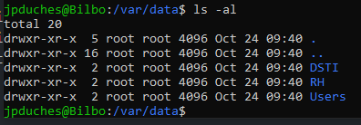
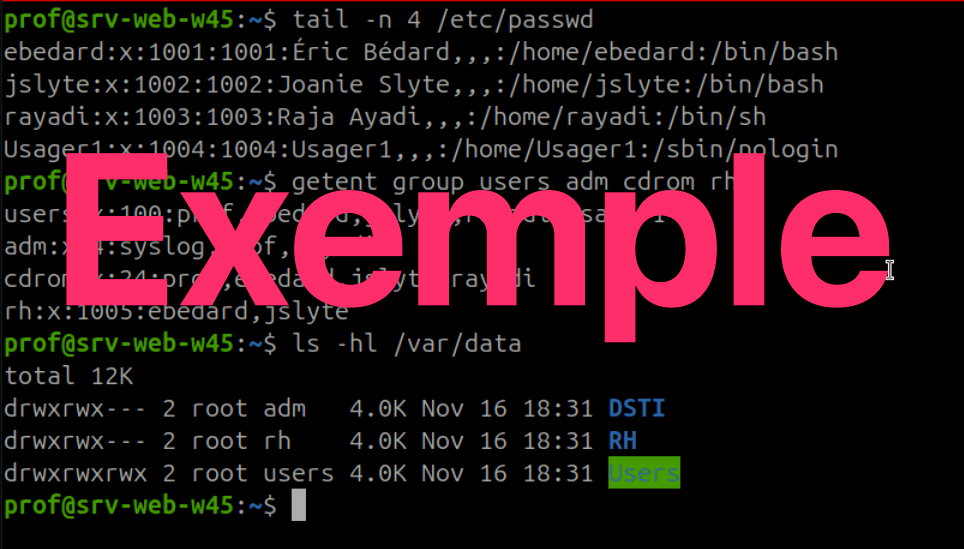
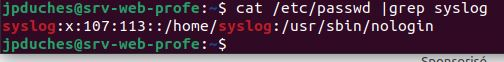
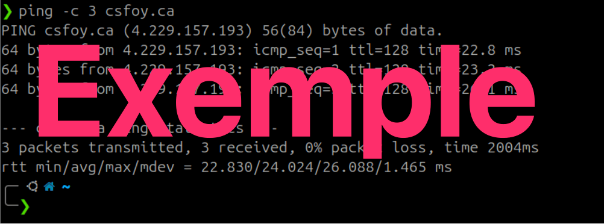

# Exercice 5 - Administration d'un système Linux

### Informations
- Évaluation : formative
- Type de travail : individuel 
- Durée estimée : 3 heures
- Système d'exploitation : Linux Ubuntu client et serveur
- Environnement : virtuel

Vous devez remettre un document Word contenant les vérifications demandées. Les informations demandées vous seront indiquées tout au long de l'exercice.

### Objectifs

- Effectuer des tâches de gestion du système d’exploitation.
- Créer correctement les comptes et les groupes d’utilisateurs.
- Attribuer correctement les droits d’accès.
- Gérer de façon appropriée les processus, la mémoire et l’espace disque.
- Localiser l'emplacement et la taille du noyau (kernel) Linux.
- Localiser les modules associés au noyau Linux.
- Vérifier les modules chargés en mémoire.
- Utiliser des commandes d'administration système.

## Section 1 - Gestion des utilisateurs

### Création d'utilisateurs

- Connectez-vous à votre serveur depuis votre station de travail.

- Vérifiez la présence du groupe suivant. S'il n'est pas présent, créez-le :

|Groupe  | Membres |
|----------  | ---------- |
| users      | tous les utilisateurs du système |

```bash
cat /etc/group | grep users
```

- En utilisant la commande `adduser`, créez les utilisateurs du tableau ci-dessous.  
- Pour les noms d'utilisateur, respectez la nomenclature : première lettre du prénom suivie du nom.  
- **Attention** : tous ces utilisateurs doivent être membres du groupe **users**. Consultez `man adduser` pour savoir comment y parvenir.  
- Vérifiez la présence du shell avant de l'ajouter à la commande. 
- L'utilisateur Usager1 ne doit pas pouvoir ouvrir une session sur le serveur.   


|Nom            | Répertoire    | Mot de passe  | Interpréteur de commande |
|----------     | ----------    | ------------- |------------- |
| Éric Bédard   | /home/ebedard | S0l&il01      |/bin/bash |
| Joanie Slyte  | /home/jslyte  | S0l&il01      |/bin/bash |
| Raja Ayadi    | /home/rayadi  | S0l&il01      |/bin/sh |
| Usager1       | aucun         | aucun         |/sbin/nologin  |


Exemple de la commande de base pour la création d'utilisateurs (il manque des paramètres pour ce qui est demandé) : 

```bash
sudo adduser ebedard
```

<details>
<summary markdown="span">Réponse :</summary>  

Pour ajouter les membres dans un groupe supplémentaire en utilisant le paramètre `--add-extra-groups`, il faut éditer le fichier `/etc/adduser.conf`. Vous devez décommenter la variable `EXTRA_GROUPS` et l'éditer pour ajouter le groupe désiré. Dans notre cas, la valeur par défaut est déjà le groupe `users`. Ouvrez le fichier `/etc/adduser.conf` pour vérifier (il est en commentaire, car c'est la valeur par défaut).

Voici des exemples de création d'utilisateurs :

```bash
sudo adduser ebedard --add-extra-groups
# Un message indique que ebedard est déjà dans le groupe users.
# Les nouveaux utilisateurs sont automatiquement ajoutés au groupe users.
sudo adduser jslyte
sudo adduser rayadi --shell /bin/sh
sudo adduser Usager1 --shell /sbin/nologin --allow-bad-names --no-create-home --disabled-login
# L'utilisation de --disabled-login rend redondant l'utilisation de --shell /sbin/nologin.
```
</details>  
<br>  

- Créez ou utilisez les groupes suivants et ajoutez-y les bons utilisateurs :

|Groupe | Membres |
|----------     | ----------    |
| users | tous les utilisateurs du système |
| adm | Vous et Raja Ayadi |
| cdrom | tous les utilisateurs du système à l'exception de Usager1 |
| rh | Éric Bédard et Joanie Slyte |  

<details>
<summary markdown="span">Réponse :</summary>  

Pour vérifier les groupes existants :  

```bash
getent group
```  
Pour vérifier les membres d'un groupe :  

```bash
getent group {nom_du_groupe}
```  

Pour créer un groupe et y ajouter un membre :

```bash
sudo groupadd admin
sudo usermod -aG admin rayadi
```

</details>

<br> 

- Modifiez les mots de passe des utilisateurs **ebedard** et **jslyte** par « Pa$$word01 » (sans les guillemets).

### Création d’une structure de fichiers

- Créez la structure suivante sur le serveur : 



- Modifiez les attributs de ces répertoires de la manière suivante :

1. DSTI : 

   - Propriétaire : root.  
   - Groupe : adm.  
   - Accessible en lecture, écriture et exécution pour le propriétaire.   
   - Accessible en lecture, écriture et exécution pour le groupe adm.  
   - Pas accessible pour les autres.  

2. RH :  

   - Propriétaire : root.  
   - Groupe : rh.  
   - Accessible en lecture, écriture et exécution pour le propriétaire.  
   - Accessible en lecture, écriture et exécution pour le groupe rh.  
   - Pas accessible pour les autres.  

3. Users :  

   - Propriétaire : root.  
   - Groupe : users.  
   - Accessible en lecture, écriture et exécution pour le propriétaire.  
   - Accessible en lecture, écriture et exécution pour le groupe users.  
   - Accessible en lecture, écriture et exécution pour les autres.  
   - Placez un sticky bit sur le répertoire.  

### Utilisation de liens symboliques

- Pour tous les utilisateurs, sauf root, créez un lien symbolique dans leur répertoire personnel vers /var/data.
- La commande doit être exécutée à partir de votre utilisateur principal sans avoir à vous déplacer dans l'arborescence.
- Connectez-vous avec l'un des utilisateurs pour vérifier le fonctionnement du lien symbolique.

## Pour vérification
Remettez, dans le document Word de remise, une capture d’écran des commandes suivantes :

```bash
tail -n 4 /etc/passwd
getent group users adm cdrom rh
ls -hl /var/data
```  

Exemple d'image de remise :  



## Section 2 - Administration système

### Environnement Linux

- Si ce n'est pas déjà fait, connectez-vous à votre serveur depuis votre station de travail.  
- Affichez la version de votre noyau :

```bash
cat /proc/version 
# Ou 
uname -r
```

- Affichez la version d'Ubuntu :  

```bash
lsb_release -a
``` 

- Vous allez localiser le noyau Linux :

```bash
cd /boot
ls -lh
```

- Dans ce répertoire, le nom du fichier binaire compressé du noyau Linux commence par `vmlinuz-`*version*.  
- Regardez son nom complet et sa taille.  

- À partir des liens symboliques, essayez de déterminer quelle est la version utilisée.
- Pour voir les modules chargés : 

```bash
cat /proc/modules | less
```  

- Ce sont tous les modules chargés dans le noyau.
- Entrez la commande :

```bash
lsmod | less
```

- Faites `man lsmod`. Y a-t-il un manuel pour cette commande ?  
- Si le manuel n'est pas installé sur votre machine, cherchez l'information sur le Web.  
- On vous proposera aussi de lire sur `modprobe` et `modinfo`.  
- Essayez la commande suivante :   

```bash
modinfo cryptd
```

- Vous voyez un module qui est responsable de la cryptographie asynchrone.  
- Entrez la commande :  

```bash
lsmod | grep x_tables
```

- Ce module est responsable de l'outil *userspace* `iptables` qui permet de configurer le coupe-feu `Netfilter`.   
- Trouvez-vous le module nommé `x_tables` ?
- Entrez maintenant la commande :

```bash
sudo iptables -vnL 
```

- Cette commande affiche les règles par défaut du coupe-feu. Actuellement, seules les règles de Docker y figurent.

[Pour en savoir un peu plus sur iptables](https://www.linuxtricks.fr/wiki/iptables-quelques-trucs-utiles)  

**Note :** La commande `iptables` est considérée comme désuète, mais encore beaucoup utilisée pour configurer Netfilter. Elle est remplacée par `nftables` : [https://wiki.nftables.org/wiki-nftables/index.php/What_is_nftables%3F](https://wiki.nftables.org/wiki-nftables/index.php/What_is_nftables%3F). Malheureusement, Docker utilise encore `iptables` et non `nftables`.  

- Vous pouvez refaire l'ensemble de la partie précédente sur votre poste client pour voir s’il y a des différences.

### Commandes d'administration système

#### Les disques 

- Vous connaissez déjà la commande :

```bash
df -H
```

- Essayons maintenant :

```bash
sudo fdisk -l | less
```

- Essayons maintenant les commandes pour voir les partitions LVM : 

```bash
sudo pvdisplay
sudo vgdisplay
sudo lvdisplay
```

- Affichez le contenu du fichier `/etc/fstab` :

```bash
sudo cat /etc/fstab
```

**Question** : Quelle est l'utilité du fichier /etc/fstab ?  

- Essayez `man fstab`.

<details>
<summary markdown="span">Réponse :</summary>  

Le fichier fstab (file systems table) est la table des différents systèmes de fichiers sur un ordinateur sous Unix/Linux : il contient une liste des disques utilisés au démarrage et des partitions de ces disques. Pour chaque partition, il indique comment elle sera utilisée et intégrée à l’arborescence du système de fichiers global (c'est-à-dire le point de montage).  

</details>

#### Gestion des processus  

- Entrez la commande :  

```bash
ps 
```

- Vous voyez les processus appartenant à votre utilisateur.  
- Ajoutez les paramètres suivants :  

```bash
ps aux
```

- Vous voyez maintenant l'ensemble des processus de votre système. Remarquez la dernière ligne : elle représente la commande que vous venez d'exécuter, qui est elle aussi un processus.  

- Entrez la commande :  

```bash
ps -ef
```

**Question** : Indiquez quel est le premier processus lancé (celui en haut de la liste).   

<details>
<summary markdown="span">Réponse :</summary>  

```text
UID      PID     PPID   C STIME  TTY          TIME CMD
root       1        0   0 Nov12  ?        00:00:23 /usr/lib/systemd/systemd --system --deserialize=82
```

</details>
<br>  

- Entrez la commande :

```bash
ps aux | grep syslog  
```

- Vous devriez voir deux processus : 
    - Le premier est le processus `syslog` (/usr/sbin/rsyslogd).
    - Le deuxième est votre commande `ps aux` avec le `grep`.

**Question** : Qui est le propriétaire du processus rsyslogd ?  

<details>
<summary markdown="span">Réponse :</summary>  
syslog  
</details>
<br>  

**Question** : Quel est le numéro (UID) de l'utilisateur propriétaire du processus ?

<details>
<summary markdown="span">Réponse :</summary>  

```bash
cat /etc/passwd | grep syslog
```  



</details>
<br>  

**Question** : Est-ce que cet utilisateur a accès à un shell ?

<details>
<summary markdown="span">Réponse :</summary>  

Non.  
syslog:x:107:113::/home/syslog:**/usr/sbin/nologin**

</details>
<br>  

**Question** : Est-ce que cet utilisateur est membre d'un groupe ?

<details>
<summary markdown="span">Réponse :</summary>  

Oui, de deux groupes : adm et syslog.  

```bash
groups syslog
```  

</details>
<br>  

---

**Sur votre poste client.**  

- Entrez la commande `top` :

```bash
top
```

- Remarquez les informations suivantes : le nombre total de tâches affichées, l'utilisation du CPU, la mémoire vive et la partition d'échange SWAP.  
- Laissez `top` ouvert et ouvrez le navigateur Firefox.  
- Dans une autre fenêtre de commandes, entrez les commandes suivantes : 

```bash
pidof firefox
# Vous devriez avoir plusieurs processus.  

kill $(pidof firefox)  
# Firefox s'est fermé.  
```

- Fermez top.  

### La recherche de fichiers  

- Entrez la commande :  

```bash
cd
```

**Question** : Dans quel répertoire vous ramène cette commande ? 

<details>
<summary markdown="span">Réponse :</summary>  

- Utilisez `pwd` pour vous aider.  
- Vous devez être dans votre répertoire d'utilisateur.  

Remarque : votre répertoire personnel par défaut est indiqué par le tilde dans l’invite de commandes.
</details>
<br>  

**Attention** : si la commande `locate` n'existe pas, installez le paquet `plocate`.

<details>
<summary markdown="span">Installation de plocate.</summary>  

```bash
sudo apt install plocate -y  
```  

</details>
<br>  

- Entrez la commande :

```bash
touch toto.txt
# Puis :
locate toto.txt
```

**Question** : Est-ce que votre fichier nouvellement créé a été trouvé ?

<details>
<summary markdown="span">Réponse :</summary>  

Non, vous ne trouvez pas le fichier, car `locate` cherche dans une base de données. Si celle-ci n'a pas été mise à jour, vous ne pouvez pas trouver les informations.
Pour mettre à jour la base de données sur laquelle se fie l'index utilisé par la commande locate, il faut utiliser la commande `sudo updatedb` (régulièrement).  

</details>
<br>  

- Entrez la commande `sudo updatedb`, puis refaites la commande `locate toto.txt`. Vous devriez maintenant trouver le fichier `toto.txt`.  
- Entrez maintenant la commande :

```bash
touch toto2.txt
# Puis :
locate toto2.txt # Rien : la base de données n'est pas à jour.

# Allons-y plutôt avec find :
find . -name toto2.txt
```

**Question** : Est-ce que le fichier nouvellement créé a été trouvé ?

<details>
<summary markdown="span">Réponse :</summary>  

Oui.

`find` cherche dans le système de fichiers. La commande n'a pas besoin d'index. La commande `find` est un outil puissant qui permet aux administrateurs système de localiser et de gérer des fichiers et des répertoires en fonction d'un large éventail de critères de recherche. Elle peut trouver des répertoires et des fichiers par leur nom, leur type ou leur extension, leur taille, leurs autorisations, etc.
Son apprentissage vous fera gagner beaucoup de temps.

La syntaxe générale de la commande find est :

```bash
find {chemin} -name {nom} {action}
```

- `{chemin}` : répertoire à partir duquel la recherche est faite.  
- `{nom}` : nom du fichier ou du répertoire à rechercher.  
- `{action}` : action facultative à effectuer sur les résultats, comme copier, supprimer, déplacer, etc.  

</details>
<br>  

- Entrez maintenant la commande :

```bash
find / -name toto2.txt
```

**Question** : Pourquoi avez-vous des messages d'erreur ?

<details>
<summary markdown="span">Réponse :</summary>  

Vous faites une recherche à partir de la racine (/), donc dans tout le système de fichiers. Il y a des répertoires où vous n'avez pas de droits de lecture.

Changez la commande en ajoutant sudo devant et vous devriez avoir beaucoup moins de messages d'erreurs. Par contre, le temps de réponse est un peu long, car vous lui avez demandé de chercher dans toute l'arborescence de fichiers (/) et non seulement dans l'emplacement courant (.).
</details>
<br>  

- Entrez maintenant les commandes suivantes :

```bash
which find

# Lire les informations sur la commande which.
man which
```  

---

### Vérifier votre configuration réseau

**Sur votre serveur.**

Pour vérifier la configuration de votre réseau :

- Vérifiez d'abord les adresses IP :

```bash
ip -4 a
```

- La passerelle doit être vérifiée pour savoir si l'on peut sortir du réseau local. 

```bash
ip route
# default est votre passerelle.
# Vérifiez la réponse de la passerelle avec un ping : 
ping -c 3 {Adresse IP passerelle}
```

- Par la suite, nous voulons savoir si la résolution de noms fonctionne : 

```bash
# Résolution de noms au niveau local :
cat /etc/hosts
ping localhost # Ping sur la boucle locale
# ctrl-c pour arrêter le ping
ping -c 3 {nomVotreMachine} # Nom de votre machine, associé à une adresse commençant par 127.0.1.1

# Résolution de noms au niveau des serveurs DNS

sudo systemctl status systemd-resolved.service
resolvectl status  
# Prenez en note l'adresse du serveur DNS.
```

- Vérifiez si vous atteignez les serveurs DNS :  

```bash
ping -c 3 {Adresse IP du serveur DNS}
```

- Faites un ping sur le FQDN (*Fully Qualified Domain Name*) du cégep :  

```bash
ping -c 3 csfoy.ca  
```

- Si tout fonctionne, vous êtes satisfait ;-) 

Vous avez une connectivité avec Internet.

## Pour vérification
Remettez, dans le document Word de remise, une capture d’écran de la commande suivante :

```bash
ping -c 3 csfoy.ca
```

Exemple d'image de remise :  



## Références

[Tutoriel pour comprendre et changer de noyaux Linux avec Ubuntu 20.04 LTS](https://lafibre.info/serveur-linux/noyaux-linux/)

---  
*Version 2026-11-16*


