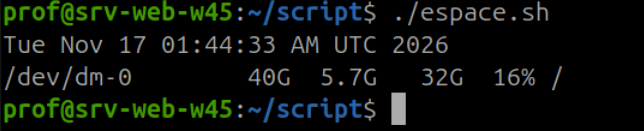

# Exercice 6 - Installation d'un environnement de tests sur site

### Informations  

- Type de travail : individuel
- Durée estimée : 2 heures
- Système d'exploitation : Linux Ubuntu client et serveur
- Environnement : virtuel

Dans cet exercice, nous allons mettre en place un environnement de tests. Pour rappel, c'est l’environnement de simulation. Généralement, l’environnement de simulation est identique à celui de production, si bien que le matériel et les logiciels ne présentent pas de grandes différences lors de l’utilisation de l’application.

### Objectifs  

Comprendre l'installation native d'une pile LAMP, en utilisant Nginx au lieu d'Apache.  

Donc, nous aurons les composants suivants :  

- Nginx : serveur Web  
- MySQL : serveur de bases de données  
- PHP : langage de programmation

## Section 1 - Préparation et Mise à jour du système

C'est une bonne habitude de mettre à jour vos dépôts et votre système avant de procéder à des installations.

### Mise à jour du poste client

- Procédez à la mise à jour de votre poste client : 

```bash
sudo apt update && sudo apt full-upgrade -y
```

### Connexion au serveur

- Utilisez votre machine Ubuntu client (poste de développeur) pour établir une connexion avec votre serveur.

```bash
ssh {utilisateur}@{adresse IP du serveur} [-p port]

# Si vous avez un fichier ~/.ssh/config
ssh website
```
 
>**Attention** : nous allons régulièrement avoir besoin d'un éditeur de texte en mode console. Vous pouvez utiliser l'un des éditeurs suivants : 
>
>**nano** : l'éditeur le plus simple, installé par défaut dans Ubuntu.
>
>**vim** (ou vi) : présent dans 99 % des systèmes Unix/Linux. Il est plus difficile à apprivoiser, mais très puissant. Voici un tutoriel en français si vous voulez vous y mettre : [l'éditeur de texte vi](https://linux.goffinet.org/administration/traitement-du-texte/editeur-de-texte-vi/) ou un petit jeu [https://vim-adventures.com/](https://vim-adventures.com/).  

### Script de suivi de l'espace disque

- Vérifiez l'espace disque avant l'installation des applications supplémentaires. Créez un script bash pour obtenir l'information sur l'espace disque (voir ci-dessous).

<details>
<summary markdown="span">Script d'information sur l'espace disque</summary>  

- Pour ce faire, créez un script bash sur votre serveur que vous pourrez utiliser de façon périodique :

```bash
mkdir scripts
cd scripts
nano espace.sh
```

Contenu du script :

```bash
#!/bin/bash
# Variable contenant le nom du fichier qui conservera les informations :
Fichier="./espaceDisque.txt"

date >> $Fichier   # Pour avoir la date et l'heure de l'exécution.
df -H | grep /dev/dm-0 >> $Fichier # Envoi de l'information dans le fichier (ajustez selon le nom de votre disque).
# Le script affiche le résultat :
cat $Fichier
```

- Sauvegardez votre fichier avec Ctrl+X, répondez *Y* lorsqu'on vous demande de l'enregistrer, puis appuyez sur Entrée pour confirmer le nom du fichier.  
- Exécutez la commande suivante pour rendre le script bash exécutable : 

```bash
chmod a+x espace.sh
# Pour exécuter votre script bash :
./espace.sh
```

Voici le résultat attendu :


</details>
<br>

### Mise à jour du serveur

- Procédez à la mise à jour du serveur.

```bash
sudo apt update && sudo apt upgrade -y
```  

- Lancez votre script `espace.sh`.
- Vous ne devriez pas voir de différence notable, car une mise à jour ne prend pas beaucoup d'espace disque.  

## Section 2 - Installation de Nginx

```bash
sudo apt install nginx -y
```

### Vérification de l'installation de Nginx

- Vérifiez le fonctionnement du serveur en tapant la commande suivante :  

```bash
sudo systemctl status nginx
```

- Vérifiez le fonctionnement de votre serveur Web en entrant l'adresse IP de votre serveur dans le navigateur de votre poste client. ([Exemple de résultat.](../images/nginx.png))


## Section 3 - Installation du serveur MySQL

```bash
sudo apt install mysql-server -y
```

### Sécurisation de MySQL

- Vous allez exécuter le script de sécurité MySQL. ([Documentation MySQL](https://dev.mysql.com/doc/refman/9.7/en/mysql-secure-installation.html))
- Ce programme vous permet d'améliorer la sécurité de votre installation MySQL de la manière suivante :
    - Vous pouvez supprimer les comptes root qui sont accessibles depuis l'extérieur de l'hôte local.
    - Vous pouvez supprimer les comptes d'utilisateurs anonymes.
    - Vous pouvez supprimer la base de données de test (à laquelle tous les utilisateurs, même anonymes, peuvent accéder par défaut) et les privilèges qui permettent à quiconque d'accéder aux bases de données dont le nom commence par `test_`.

```bash
sudo mysql_secure_installation
```

- Le plug-in `validate_password` peut être utilisé pour vérifier la force des mots de passe. Si le plug-in n'est pas installé, `mysql_secure_installation` demande à l'utilisateur s'il doit l'installer. Tous les mots de passe saisis ultérieurement sont vérifiés à l'aide du plug-in s'il est activé. 
- Ensuite, le programme d’installation décrira les fonctionnalités du plug-in `validate_password`. Vous devrez sélectionner le niveau de sécurité. 
    - Vous devez choisir **2 pour STRONG**. 
    - Nous devons placer notre serveur comme si nous étions en production, et non en développement comme votre poste client. Choisissez donc le niveau de sécurité le plus élevé.
    - Le niveau STRONG exige un mot de passe d'au moins 8 caractères, avec des chiffres, des majuscules et des minuscules, des caractères spéciaux, et qui n'est pas un mot du dictionnaire.
    - **Exemple** : `e4l*j3Wj`

- Le système vous demandera les fonctions de sécurité suivantes : 
    - Supprimer les utilisateurs anonymes ? Y
    - Désactiver la connexion root à distance ? Y
    - Supprimer la base de données de test et l'accès à celle-ci ? Y
    - Recharger les tables de privilèges maintenant ? Y

### Vérification du service MySQL

- Pour vérifier que MySQL fonctionne, entrez la commande :  

```bash
sudo systemctl status mysql.service
```  

- Par curiosité, lancez votre script d'espace disque. Vous verrez combien d'espace utilise le serveur de bases de données MySQL, sans aucune base de données bien sûr. 

```bash
./espace.sh
```

[Cliquez pour voir mon résultat](../images/espace2.png)  

- Vérifiez les connexions possibles au serveur MySQL (pour savoir s'il y a un port d'écoute) : 

```bash
sudo ss -tunap | grep 3306
```

Résultat attendu : 

```text
LISTEN 0    151    127.0.0.1:3306	    0.0.0.0:*    users:(("mysqld",pid=2791,fd=23))
LISTEN 0    70     127.0.0.1:33060      0.0.0.0:*    users:(("mysqld",pid=2791,fd=21))
```

### Test de l'installation de MySQL

Le client MySQL a également été installé. Nous allons l’utiliser pour tester notre installation.  

- Entrez la commande suivante pour accéder au client :

```bash
sudo mysql -u root
```  
```sql
show databases;
```  

- Avec `sudo`, vous êtes connecté sans mot de passe grâce à `auth_socket`.

[Cliquez pour voir mon résultat](../images/conMySQL.png)

- Quelques vérifications d'usage : 

```sql
select user, host from mysql.user;
```

- Créez un utilisateur pour l'administration :  

```sql
CREATE USER 'admin'@'localhost' IDENTIFIED BY 'mot_de_passe_sécuritaire';
GRANT ALL PRIVILEGES ON *.* TO 'admin'@'localhost' WITH GRANT OPTION;
```

- Vérifiez la présence de l'utilisateur : 

```sql
select user, host from mysql.user;
quit;
```

## Section 4 - Le langage de programmation PHP

Procédez à l'installation de PHP et de ses différents modules :

```bash
sudo apt install php-fpm php-cli php-mysql php-curl -y
```

### Configuration de Nginx pour PHP

- Maintenant, vous devez éditer le fichier de configuration du site virtuel par défaut de Nginx (nous verrons la configuration de Nginx plus en détail plus tard dans la session).  
- Avant de modifier un fichier de configuration, faites toujours une copie de sauvegarde comme ceci : 

```bash
sudo cp /etc/nginx/sites-available/default /etc/nginx/sites-available/default.orig
# En cas d'erreur introuvable dans le fichier, vous pourrez revenir
# au fichier original en inversant la commande : 
sudo cp /etc/nginx/sites-available/default.orig /etc/nginx/sites-available/default
```

- Ouvrez le fichier suivant :  

```bash
sudo nano /etc/nginx/sites-available/default
```

- Modifiez-le pour qu'il corresponde aux lignes ci-dessous. Vous pouvez faire une recherche dans le fichier et modifier les lignes correspondantes. Pour la version de PHP, vérifiez le nom du fichier dans `/run/php`.

```nginx
server {
        listen 80 default_server;
        listen [::]:80 default_server;
        server_name localhost;
        root /var/www/html;
        index index.php index.html index.htm index.nginx-debian.html;


    location ~ \.php$ {
        include snippets/fastcgi-php.conf;
        fastcgi_pass unix:/run/php/php8.5-fpm.sock;
    }
}
```

- Au besoin, aidez-vous du fichier suivant, tiré de mon serveur : 
[Fichier modifié](extra/default)


- Enregistrez et fermez le fichier, puis activez le fichier de configuration de l'hôte virtuel Nginx avec la commande suivante :  

```bash
sudo ln -sf /etc/nginx/sites-available/default /etc/nginx/sites-enabled/
```

- Ensuite, vérifiez la configuration de Nginx pour éviter toute erreur de syntaxe avec la commande suivante :

```bash
sudo nginx -t
```

- Vous devriez obtenir le résultat suivant :

```text
nginx: the configuration file /etc/nginx/nginx.conf syntax is ok
nginx: configuration file /etc/nginx/nginx.conf test is successful
```

- Enfin, redémarrez le service Nginx pour appliquer les changements de configuration :

```bash
sudo systemctl restart nginx
sudo systemctl status nginx
```

### Vérification du fonctionnement de PHP

- Créez un fichier `info.php` contenant du code PHP de vérification dans le répertoire racine du serveur Web (`/var/www/html`). Procédez ainsi : 
 
```bash
sudo nano /var/www/html/info.php
```  

- Contenu du fichier PHP :

```php
<?php
phpinfo();
?>
```

- Ouvrez ce fichier dans votre navigateur en entrant l'URL suivante :

`http://{adresse IP du serveur}/info.php`

[Image du navigateur](../images/info.png)

- Le fichier `info.php` permet d'afficher les paramètres de PHP. Ces informations sont utiles si vous souhaitez vérifier votre configuration d’hébergement ou exécuter un logiciel qui nécessite des modules PHP spécifiques.  
- Après avoir vérifié l'information, dans un environnement de production, vous devriez supprimer ce fichier.

## Section 5 - Finalisation

- Lancez le script `espace.sh`.
- Analysez l'espace disque utilisé par vos installations.

---  
*Version 2026-11-17*
